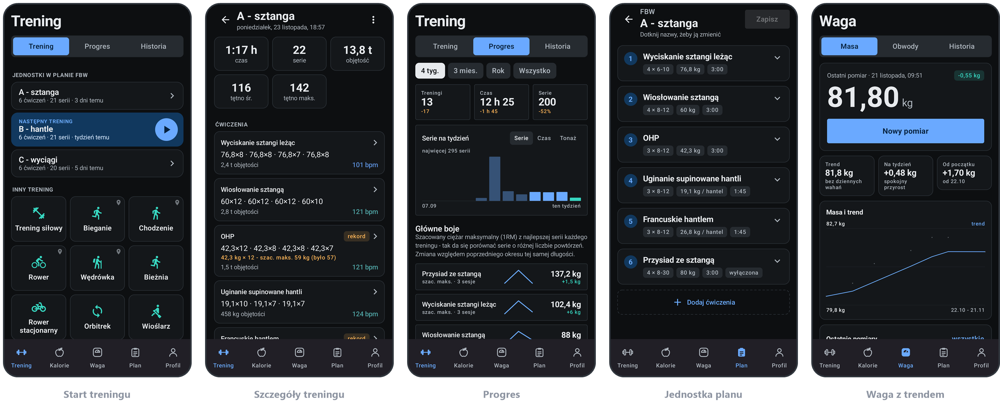

<div align="center">

# GymBro

**Dziennik treningu siłowego na Androida.**<br>
Plan, serie, progresja, jedzenie i waga - w jednej aplikacji, na jednym telefonie.



</div>

## Co potrafi

- **Plan i trening.** Gotowe plany (FBW, PPL i ponad pięćdziesiąt innych) albo własne jednostki. Trening prowadzi się ćwiczenie po ćwiczeniu, z odliczaniem przerwy i pokrętłem do ciężaru.
- **Progresja.** Po treningu aplikacja proponuje ciężar i powtórzenia na następny raz. Liczy je z tego, co faktycznie poszło, i z talerzy, które naprawdę leżą na siłowni.
- **Historia i progres.** Każdy trening z seriami, tętnem na tle serii i porównaniem z poprzednim razem. Rekordy, szacowany maks. w głównych bojach i tygodniowa mapa partii w Progresie. Bieg, spacer i rower nagrywa się z GPS-em, z mapą trasy.
- **Jedzenie.** Dziennik kalorii z bazą produktów i własnymi daniami. Cel liczy się z fazy (redukcja, utrzymanie, masa) i z wydatku wyliczonego z ważeń.
- **Waga.** Pomiar z wagi łazienkowej po Bluetooth, trend masy i obwody.

## Dodatkowo: pilot na zegarku


Na Amazfit Balance jest mini-aplikacja, która prowadzi trening bez wyjmowania telefonu: jedno kliknięcie na serię, przerwa odlicza się na pierścieniu, zapas powtórzeń to dwa dotknięcia.

Zegarek nic nie liczy - wysyła polecenie do telefonu i rysuje odpowiedź. Bez zasięgu serie czekają w kolejce i dojeżdżają później.

<sub>Ekrany po prawej są wyrenderowane z kodu mini-aplikacji.</sub>

<br clear="right">

## Budowanie

| Katalog | Co | Technologie |
|---|---|---|
| [`GymBro/`](GymBro) | aplikacja na Androida | Kotlin, Jetpack Compose, SQLite bez ORM |
| [`gymbro-watch/`](gymbro-watch) | mini-aplikacja na zegarek | Zepp OS 3.0, JavaScript |

```sh
GymBro/tools/gr.sh :app:assembleDebug     # APK - w repozytorium nie ma gradlew
GymBro/tools/gr.sh :app:testDebugUnitTest
cd gymbro-watch && node tools/check.js && zeus build
```

Więcej: [progresja.md](GymBro/docs/progresja.md), [kalorie.md](GymBro/docs/kalorie.md), [sklad-ciala.md](GymBro/docs/sklad-ciala.md), [GymBro/README.md](GymBro/README.md), [CLAUDE.md](CLAUDE.md).
