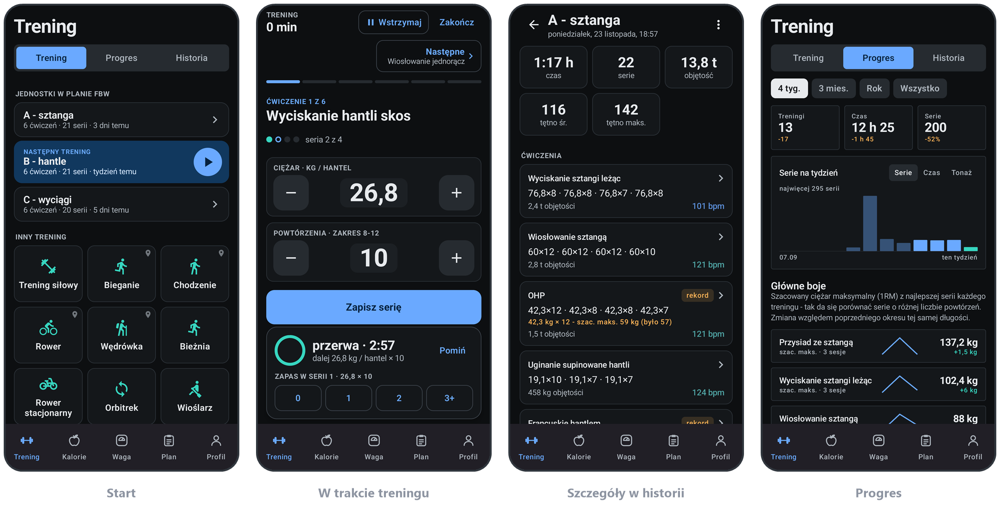
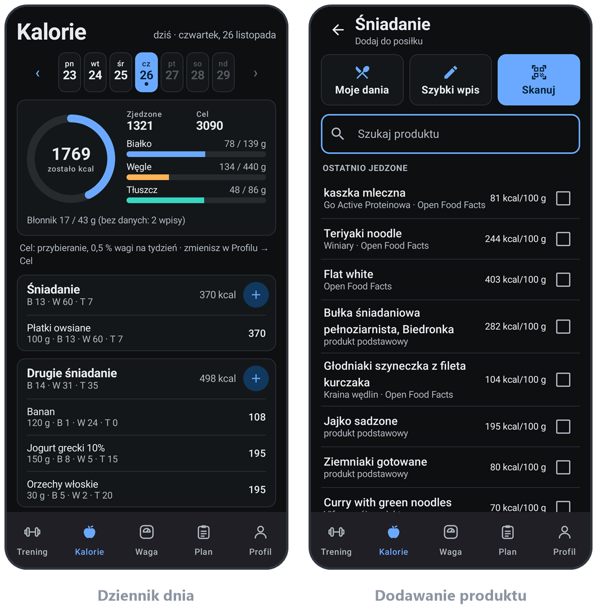
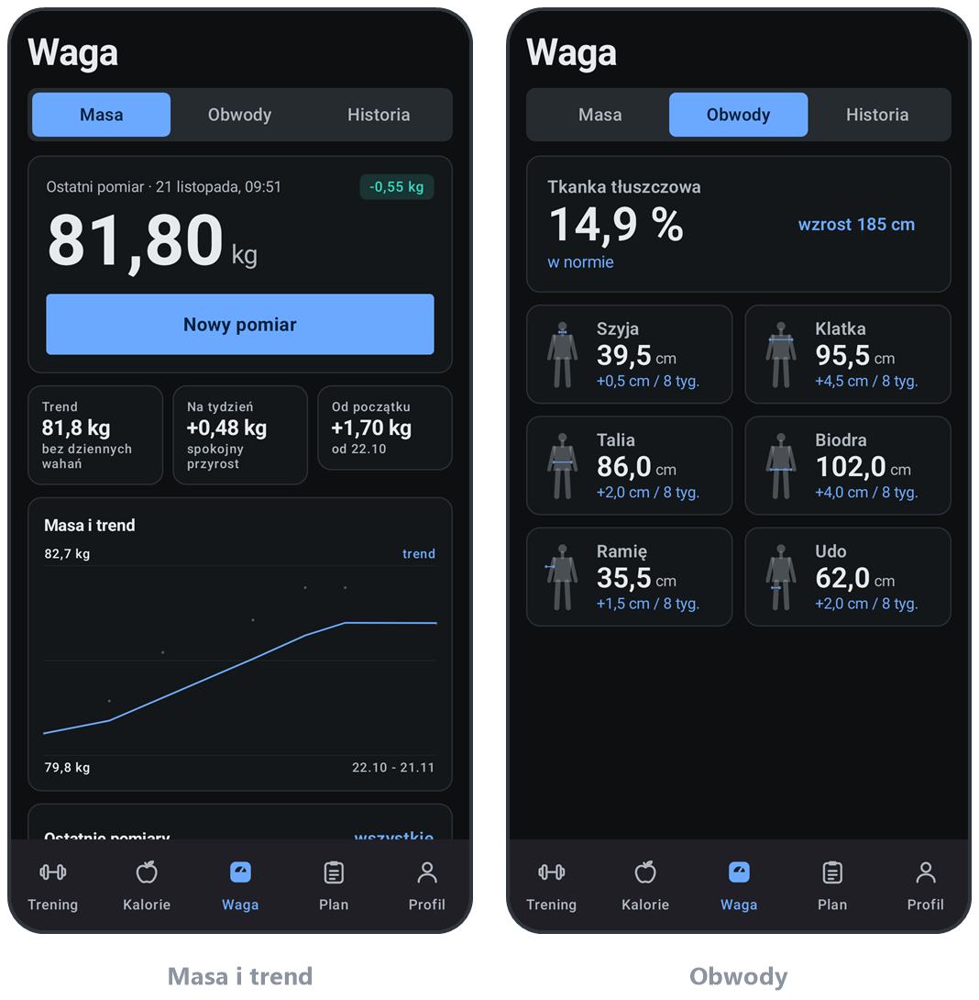
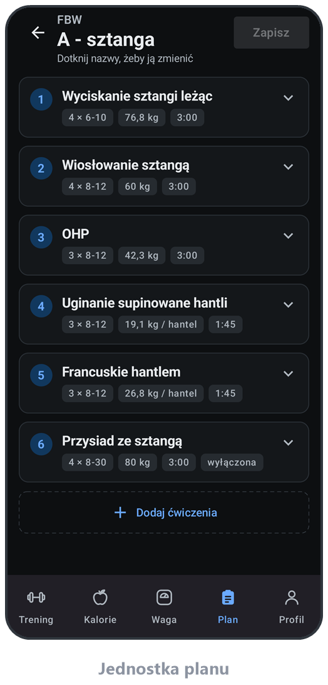
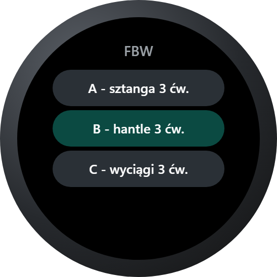

<div align="center">

# GymBro

**Dziennik treningu siłowego na Androida.**<br>
Plan, serie, progresja, jedzenie i waga - w jednej aplikacji, na jednym telefonie.

</div>

## Trening

W zakładce Trening możemy rozpocząć trening. Do wyboru mamy jednostki z własnego planu - następna w kolejce jest wyróżniona - albo inny trening z dostępnych: bieg, spacer, rower czy zwykły trening siłowy. W trakcie treningu na ekranie jest jedno ćwiczenie naraz: ustawiamy ciężar i powtórzenia, zapisujemy serię, a przerwa odlicza się sama.

W Progresie widać, jak rośnie siła w głównych bojach i w których ćwiczeniach od dłuższego czasu nie ma żadnych wzrostów. W Historii znajdziemy każdy trening z seriami, tętnem i porównaniem z poprzednim razem.



## Kalorie

W zakładce Kalorie zapisujemy, co jemy w ciągu dnia, z podziałem na posiłki. Produkt możemy wyszukać po nazwie albo zeskanować jego kod kreskowy, a to, co jemy często, zapisać jako własne danie. Na górze widać, ile kalorii, białka, węglowodanów i tłuszczu zostało do dziennego celu.



## Waga

W zakładce Waga zapisujemy pomiary masy ciała - z wagi łazienkowej przez Bluetooth albo ręcznie. Wykres pokazuje trend bez dziennych wahań, więc łatwo ocenić, czy masa naprawdę rośnie, czy spada. Możemy też zapisywać obwody ciała, z których aplikacja szacuje poziom tkanki tłuszczowej.



## Plan

W zakładce Plan układamy plan treningowy. Możemy wybrać jeden z ponad pięćdziesięciu gotowych planów, na przykład FBW albo PPL, albo stworzyć własny od zera. Każda jednostka to lista ćwiczeń z liczbą serii, zakresem powtórzeń, ciężarem i przerwą. Po treningu aplikacja proponuje tu zmiany - większy ciężar albo dodatkową serię - a my decydujemy, czy je przyjąć.



## Profil

W zakładce Profil zaznaczamy sprzęt, który mamy do dyspozycji. Aplikacja pokazuje wtedy tylko plany i ćwiczenia możliwe do wykonania tym sprzętem, a po wpisaniu gryfu i talerzy proponuje wyłącznie ciężary, które da się z nich złożyć.

## Dodatkowo: pilot na zegarku



Na Amazfit Balance jest mini-aplikacja, która prowadzi trening bez wyjmowania telefonu: jedno kliknięcie na serię, przerwa odlicza się na pierścieniu, zapas powtórzeń to dwa dotknięcia.

Zegarek nic nie liczy - wysyła polecenie do telefonu i rysuje odpowiedź. Bez zasięgu serie czekają w kolejce i dojeżdżają później.

<sub>Ekrany po prawej są wyrenderowane z kodu mini-aplikacji.</sub>

<br clear="right">

## Budowanie

| Katalog | Co | Technologie |
|---|---|---|
| [`GymBro/`](GymBro) | aplikacja na Androida | Kotlin, Jetpack Compose, SQLite bez ORM |
| [`gymbro-watch/`](gymbro-watch) | mini-aplikacja na zegarek | Zepp OS 3.0, JavaScript |

```sh
GymBro/tools/gr.sh :app:assembleDebug     # APK - w repozytorium nie ma gradlew
GymBro/tools/gr.sh :app:testDebugUnitTest
cd gymbro-watch && node tools/check.js && zeus build
```

Więcej: [progresja.md](GymBro/docs/progresja.md), [kalorie.md](GymBro/docs/kalorie.md), [sklad-ciala.md](GymBro/docs/sklad-ciala.md), [GymBro/README.md](GymBro/README.md), [CLAUDE.md](CLAUDE.md).
